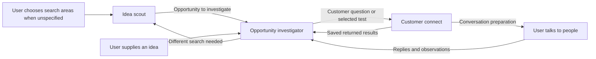

# Project skill map

This is the shared map of this project's startup workflow: which skills exist, what each owns and how work passes between them. Every participating skill reads this file at the start of a run and uses it to explain the next step. Read another skill's instructions when handing work to it; awareness of the map does not require loading every skill on every run.

## Current skills

| Skill | Use it for | Inputs and saved outputs |
| --- | --- | --- |
| [startup-idea-scout](.agents/skills/startup-idea-scout/SKILL.md) | Help choose search areas, discover and compare ideas, assess a supplied idea, or resume a search | For an unspecified broad search, offers random industries plus saved leads and waits for the user's area choices. Uses the founder profile and chosen brief. Saves one run file in `scouting-runs/`; promotes the strongest recommendation or a selected idea into its opportunity folder. |
| [startup-opportunity-investigator](.agents/skills/startup-opportunity-investigator/SKILL.md) | Investigate a chosen opportunity, assess business viability and costs, design customer tests, or reassess returned evidence | Accepts a scout handoff, direct idea or customer results. Maintains the opportunity's research, summary, relevant calculations, test plans and history. |
| [startup-customer-connect](.agents/skills/startup-customer-connect/SKILL.md) | Find relevant people and contact routes; prepare learning, sales or negotiation conversations; save replies | Uses the current opportunity and conversation goal or selected test. Saves contact preparation and actual returned results in the same opportunity. Returns business reassessment to the investigator. |

The [founder profile](FOUNDER-PROFILE.md) supplies shared context. The [record guide](docs/startup-skills/record-guide.md) owns record formats, evidence identity and [production boundaries](docs/startup-skills/record-guide.md#skill-boundaries). This map owns relationships and routing. These three skills remain research and preparation skills; the user's planned production skills or automations will be added when they exist.

The user's [lead notebook](.agents/skills/startup-idea-scout/references/user-leads.md) holds ideas, personal problems and inspiration. Adding a lead saves it for later choice; it does not launch research. The scout's [scope-selection method](.agents/skills/startup-idea-scout/references/discovery.md#choose-the-search-areas) governs the initial menu and when an existing scope skips it.

## How work moves

Choose the route that answers the current question. A supplied idea can enter investigation directly. The investigator can continue its own research when contacts are not yet needed. After conversation preparation, the next action may belong to the user; reassessment follows when actual results return. If a test needs a product sample, describe its requirements for the user's separate production workflow.

## Explain the next step

End each run with a concrete next plan in the final reply and the existing run or opportunity record. Include the next owner (named skill or user), the task and why it matters, the relevant record links, and what remains undecided. For a skill handoff, provide a short ready-to-use prompt with the actual opportunity or run path and the next questions. Store this in the existing record; a handoff alone needs no extra file.

After a completed scout run, normally recommend `startup-opportunity-investigator` for the leading or user-selected idea, specifying the main uncertainties to investigate. If the user has not selected an idea, label the proposed target as the scout's recommendation. If none is recommended, explain that the next step is choosing a discussion option for investigation or revising the search brief. An incomplete run points to the unfinished scout work.

An investigator handoff to customer-connect carries the current offer, customer question or test, and relevant limits. Customer-connect explains the user's next conversation step and which results to bring back to the investigator. Pass canonical evidence links and known uncertainties; a handoff is not evidence that the next stage ran.

Recommend the next stage without automatically starting it. When the user's existing request already includes that stage, continue under that authorization without asking again. Before invoking a destination, check that its skill is available. If unavailable, retain a usable handoff and explain the missing capability.

## Maintain this map

When adding, renaming, removing or changing a project workflow skill:

1. Read this map and the relevant existing skills to decide responsibility and avoid overlapping ownership.
2. Update the skill table and affected routes in the same change. Record its purpose, inputs, outputs, upstream sources and downstream destinations. Distinguish a planned addition from an available skill.
3. Make the new or changed skill read this map and follow the next-step convention. Repair affected references in other skills and shared guides; keep detailed execution instructions in the owning skill.
4. Check linked skill paths, both sides of affected handoffs, and consistency with shared record and production boundaries. Validate each edited skill.

Register skills when they become part of this project's workflow. General-purpose tools or installed skills do not need entries merely because they are available. Update this file as the common map instead of creating competing relationship documents.
